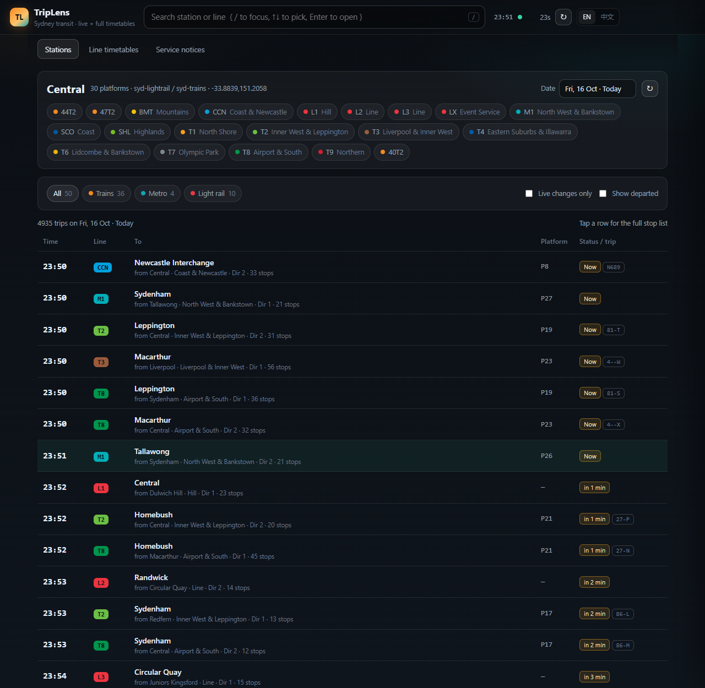
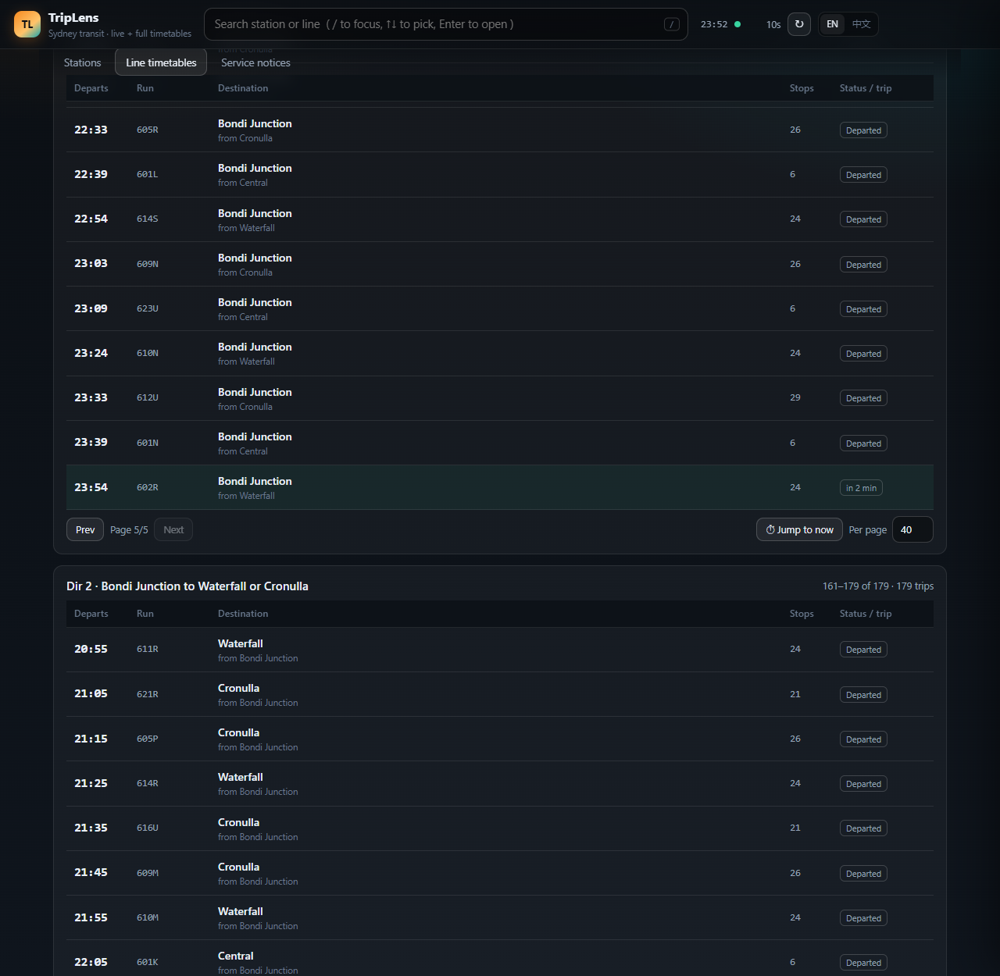
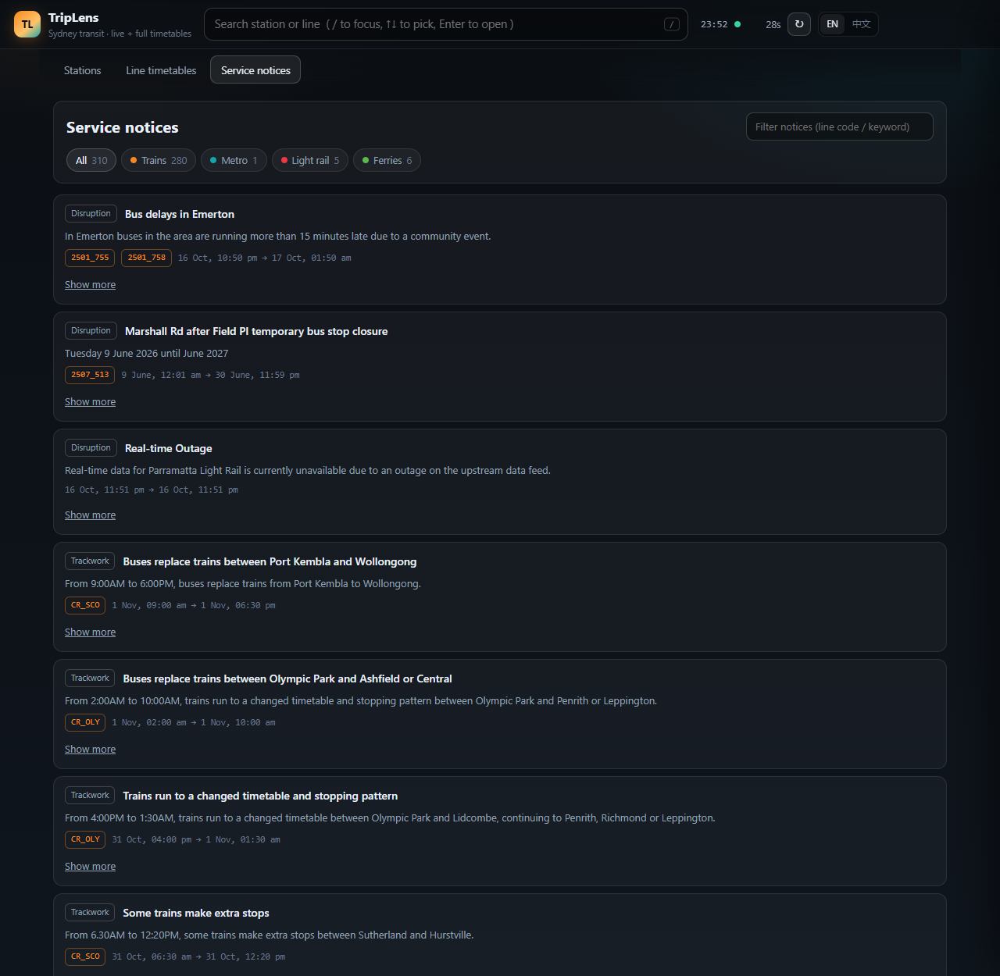

<p align="center">
  <b>English</b> · <a href="docs/README.zh-CN.md">中文</a>
</p>

<h1 align="center">TripLens</h1>

<p align="center">
  <b>A fast, local web app for querying Sydney public transport</b><br>
  live network status · per-station departure boards · complete line timetables
</p>

<p align="center">
  
</p>

---

## Features

* **Station boards** — every scheduled departure for any station and date, with live
  amendments merged in: retimed services show the live time plus the delay, platform
  changes are flagged. Filter by mode, hide departed services, page through busy hubs.

  

* **Line timetables** — pick a line, direction and period; the table opens on "now" and
  pages 20/40/80/all so long lines still fit one screen.

  

* **Home dashboard** — trips per hour by mode, per-mode totals, popular lines with
  first/last/peak frequency, and popular stations with their next departures.
* **Service notices** — disruptions, trackwork and news, filterable by mode/line/keyword.

  

* **Trip detail** — click any departure for the full stop-by-stop timetable.
* **English & Chinese UI**, auto-detected from the browser and switchable in the header.
* **Keyboard first** — `/` search, `↑ ↓` pick, `Enter` open, `Esc` close.
* **Deep links** — `#/station/Central`, `#/line/CR_ESI`, `#/alerts`.

## Quick start

Requires Python 3.10+ and internet access on first start.

```bash
pip install -r requirements.txt
python run.py                 # http://127.0.0.1:8090
python run.py --port 9000 --open --reload
```

The first start downloads and parses the timetable files (about three seconds) into
`.tdb-cache/`; afterwards the app runs from that local cache, even offline.

## Configuration

| Variable | Default | Purpose |
| --- | --- | --- |
| `TRIPLENS_REGION` | `syd` | Region whose timetable set is loaded |
| `TRIPLENS_CACHE` | `./.tdb-cache` | Where timetable files are stored |
| `TRIPLENS_API_BASE` | — | Base URL of the transit data service |

## API

The UI is a thin client over a JSON API; interactive docs at `/docs`.

```
/api/meta                service state, dates, local time
/api/search?q=           station / line typeahead
/api/popular?next=3      hub stations, optionally with next departures
/api/station?name=       station detail
/api/departures?station=&day=&limit=&network=&live=
/api/line?line=&day=&direction=&stops=
/api/trip?line=&depart=&trip=
/api/lines?day=          line catalogue (trips, first/last/peak)
/api/stats?day=          hourly profile by mode
/api/live/stations       stations with live amendments
/api/alerts?network=&q=
```

## Layout

```
triplens/
├── run.py                 launcher
└── app/
    ├── main.py            FastAPI: API + static page
    ├── service.py         schedule service (station index, boards, live merge, stats)
    ├── upstream.py        cached client for the transit data service
    ├── tdb.py             timetable file reader
    └── static/            index.html · style.css · app.js
```

## Notes

Read-only requests, aggressive caching — it is a personal query tool, not a data-mining
pipeline. TripLens is an independent project, not affiliated with any transport
authority or operator; information is provided "as is".
