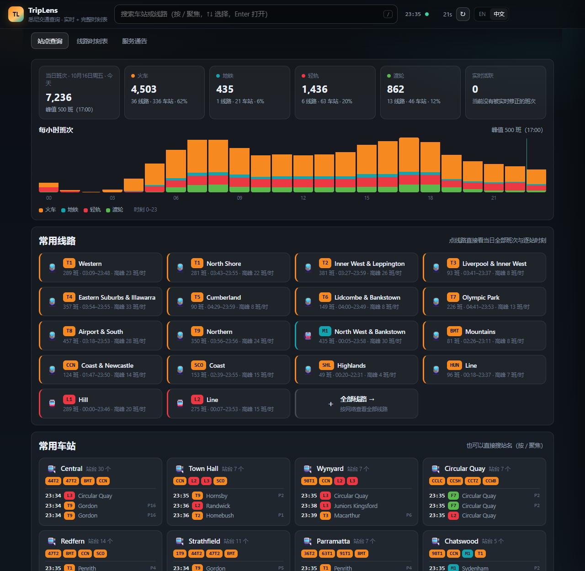

# TripLens

**A fast, local web app for querying Sydney public transport.**

Live network status, per-station departure boards and complete line timetables in one
keyboard-friendly interface. Backend in FastAPI, frontend a single dependency-free page.



---

## Features

**Station boards** — every scheduled departure for any station on any date in the
published window, with live amendments merged in: retimed services show the live time
with the scheduled time struck through plus the delay, and platform changes are flagged.
Filter by mode, hide departed services, page through a busy hub in seconds
(`preview-station.png`).

**Line timetables** — pick a line, direction and period (AM peak / daytime / PM peak /
evening). The table opens on the page containing "now" and scrolls to the next service;
paging is 20 / 40 / 80 / all per direction, so even a line with hundreds of trips stays
one screen tall (`preview-line.png`).

**Home dashboard** — the shape of the day at a glance: trips per hour stacked by mode
with the current hour marked, per-mode totals, popular lines with first/last/peak
frequency, and popular stations with their next three departures.

**Service notices** — disruptions, trackwork and news, filterable by mode, line or
keyword (`preview-alerts.png`).

**Trip detail** — click any departure to see the full stop-by-stop timetable, including
live times where they differ from the schedule.

**English and Chinese UI** — auto-detected from the browser, switchable from the header
and remembered on the device.

**Keyboard first** — `/` focuses search, `↑ ↓` picks a result, `Enter` opens it,
`Esc` closes the detail panel.

**Deep links** — every view has a URL: `#/station/Central`, `#/line/CR_ESI`,
`#/alerts`. Back/forward work as expected, so views can be bookmarked or shared.

---

## Requirements

* Python 3.10 or newer
* Internet access on first start (timetable files are fetched once, then cached)

## Quick start

```bash
cd triplens

# optional but recommended
python -m venv .venv
source .venv/bin/activate        # Windows: .venv\Scripts\activate

pip install -r requirements.txt
python run.py                    # http://127.0.0.1:8090
```

Useful flags:

```bash
python run.py --port 9000 --open       # pick a port and open a browser
python run.py --reload                 # auto-reload while developing
```

On the first start the app downloads and parses its timetable files (trains & metro,
ferries, light rail — about three seconds) and stores them in `.tdb-cache/`. After that
it runs entirely from the local cache, even offline.

## Configuration

All settings are environment variables; the defaults work out of the box.

| Variable | Default | Purpose |
| --- | --- | --- |
| `TRIPLENS_REGION` | `syd` | Region code used to select the timetable set |
| `TRIPLENS_CACHE` | `./.tdb-cache` | Where downloaded timetable files are stored |
| `TRIPLENS_API_BASE` | — | Base URL of the transit data service |

```bash
TRIPLENS_CACHE=/var/tmp/triplens python run.py
```

---

## HTTP API

The UI is a thin client over a documented JSON API. Interactive docs are served at
`/docs` (Swagger UI) and `/openapi.json`.

| Endpoint | Description |
| --- | --- |
| `GET /api/meta` | Service readiness, published date range, current local time, timetable inventory |
| `GET /api/search?q=&limit=` | Station and line typeahead |
| `GET /api/popular?limit=&next=&day=` | Hub stations, optionally with their next departures |
| `GET /api/station?name=` | Station detail: platforms, coords, lines serving it |
| `GET /api/departures?station=&day=&limit=&network=&live=&include_past=` | Departure board (schedule + live merge) |
| `GET /api/line?line=&day=&direction=&limit=&stops=` | One line's trips, optionally with per-stop times |
| `GET /api/trip?line=&depart=&trip=&day=&live=` | A single trip's stop list |
| `GET /api/lines?day=&network=` | Line catalogue with per-day trip counts, first/last/peak |
| `GET /api/stats?day=` | Day profile: trips per hour by mode, per-mode totals, live activity |
| `GET /api/live/stations?limit=` | Stations with active live amendments |
| `GET /api/alerts?network=&q=` | Service notices |
| `GET /api/timetables?load=` | Timetable inventory; load an extra file on demand |

Example:

```bash
curl 'http://127.0.0.1:8090/api/departures?station=Central&limit=5'
```

```json
{
  "station": "Central",
  "day": "2026-10-16",
  "count": 4935,
  "rows": [
    {
      "time": 1412, "clock": "23:32", "line": "T2", "network": "CR",
      "destination": "Redfern", "platform": "19", "trip": "78-V",
      "realtime": false, "stops": 21
    }
  ]
}
```

---

## Project layout

```
triplens/
├── run.py                 # launcher (uvicorn + argument parsing)
├── requirements.txt
└── app/
    ├── main.py            # FastAPI app: HTTP API + static page
    ├── service.py         # schedule service: station index, boards, live merge, stats
    ├── upstream.py        # async, cached client for the transit data service
    ├── tdb.py             # timetable file reader (container + record formats)
    └── static/
        ├── index.html
        ├── style.css
        └── app.js         # single-page UI: hash routing, i18n, rendering
```

## How it works

* **Two data layers.** Scheduled services come from timetable files that are downloaded
  once and parsed into an in-memory model — stations, lines, stop sequences, trips with
  per-stop running times and a per-trip date bitmap. Live amendments come from a small
  JSON feed that is polled and cached for a few seconds.
* **Merging.** Both layers use the same platform-level stop identifiers, and each live
  record carries the run number of the service it belongs to, so an amendment can be
  attached to the exact scheduled trip and rendered as "live time / delay / new platform".
* **Speed.** Station → line and stop-pattern → station indexes are derived once at
  startup, so a board for a major interchange with several thousand daily departures is
  assembled in well under a second; the day profile and the per-station "next departures"
  query are computed in a single pass over all trips.
* **Dates.** Each timetable file is published for a rolling window of consecutive dates.
  The UI builds its date picker from the intersection of the loaded files, and every
  query is pinned to one of those dates.

## Development notes

* Static assets are referenced with a `?v=` query string — bump the version in
  `app/static/index.html` after editing `style.css` or `app.js` so browsers pick up the
  change.
* `app/tdb.py` can also be used from the command line to inspect a timetable file:

  ```bash
  python app/tdb.py .tdb-cache/syd-trains.tdb --lines
  python app/tdb.py .tdb-cache/syd-trains.tdb --station Central --day today
  ```

* No test suite yet; the quickest manual check is `/docs` plus a station page.

## Roadmap

Ideas that would fit the current architecture: saved/favourite stations, "near me",
departure alerts, a service-worker offline shell, and additional regions.

## Notes

The app performs read-only requests and caches aggressively; please keep usage
reasonable (it is a personal query tool, not a data-mining pipeline).

---

<sub>TripLens is an independent project and is not affiliated with any transport
authority or operator. Timetables and live information are provided "as is", without
warranty of accuracy or fitness for travel decisions.</sub>
