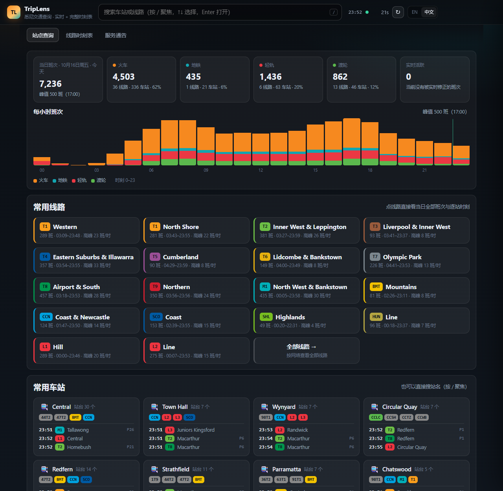
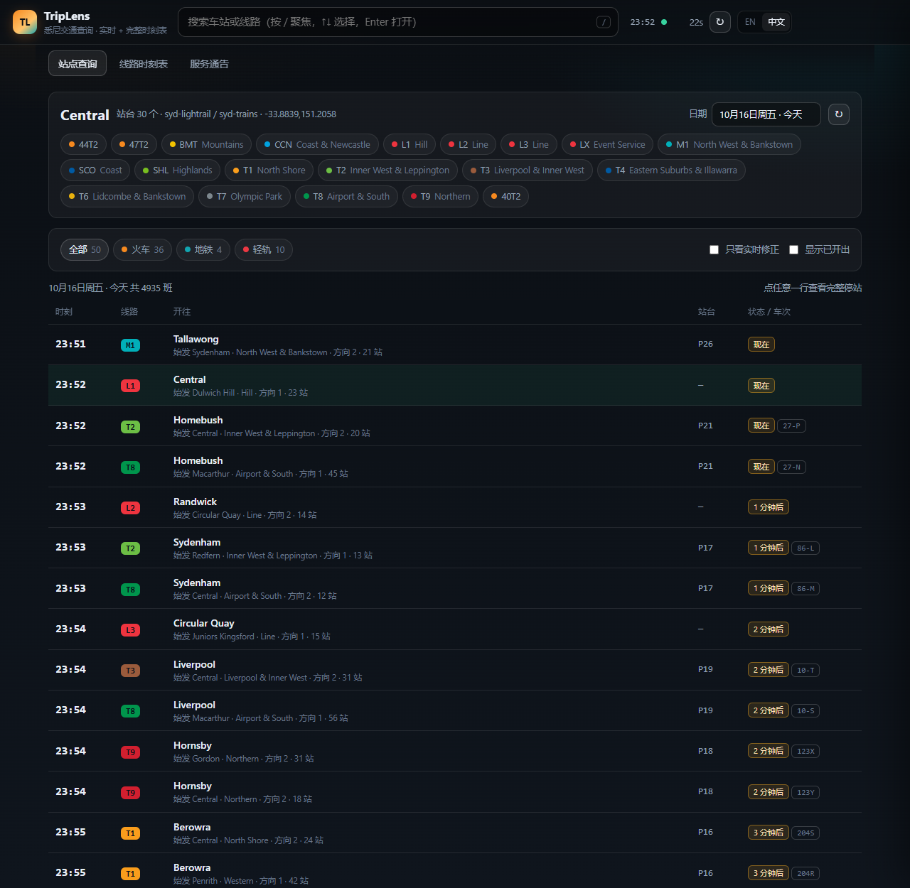
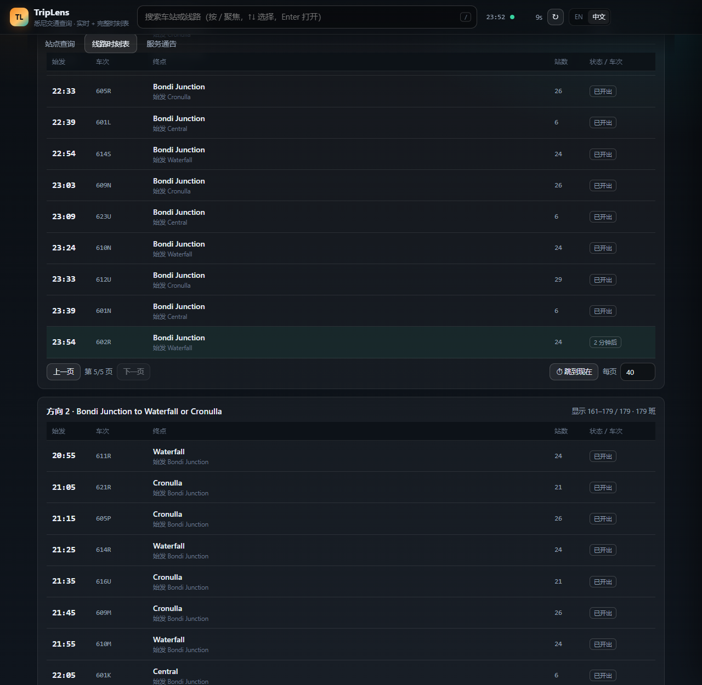
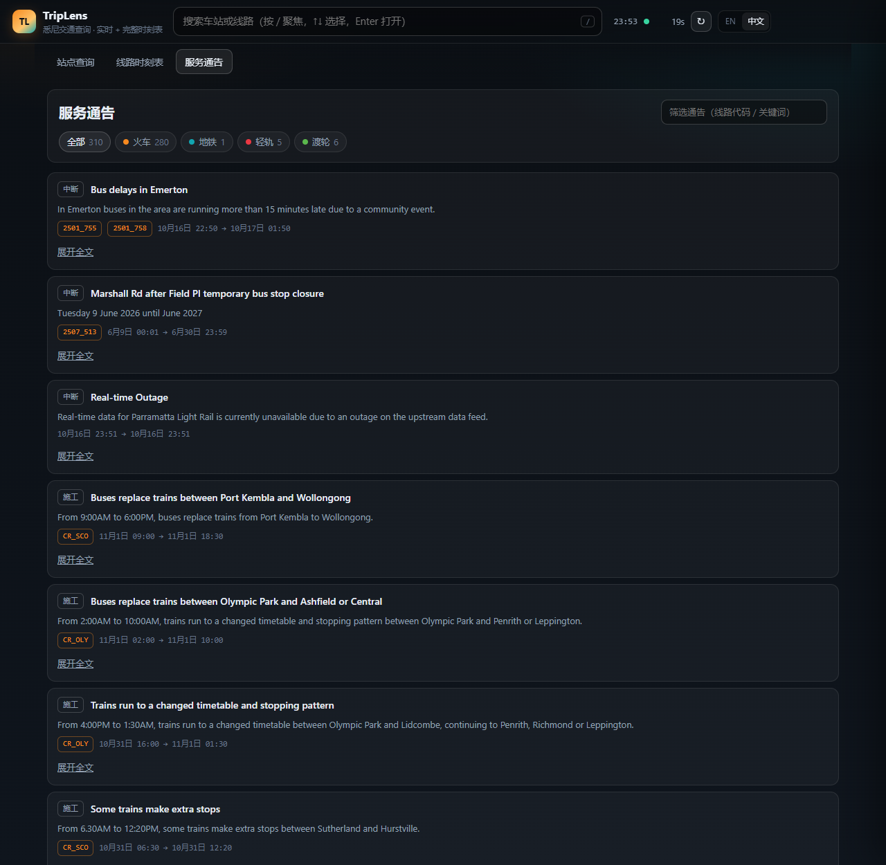

<h1 align="center">TripLens</h1>

<p align="center">
  <a href="../README.md">English</a> · <b>中文</b>
</p>

<p align="center">
  <b>一个本地运行的悉尼交通查询工具</b><br>
  实时班次 · 站点发车看板 · 完整线路时刻表
</p>

<p align="center">
  
</p>

---

## 功能

* **站点看板** —— 任一车站任一日期当天的全部计划班次，叠加实时修正（改点显示实时时刻与
  延迟，改站台会标出）。可按交通方式筛选、隐藏已开出、翻页查看。

  

* **线路时刻表** —— 选线路、方向与时段；打开即定位到"现在"，每页 20/40/80/全部，
  再长的线路也一屏放得下。

  

* **主页概览** —— 每小时班次（按交通方式堆叠）、各方式总量、常用线路（首末班与高峰
  班次）、常用车站（接下来 3 班车）。
* **服务通告** —— 中断、施工、新闻，可按方式/线路/关键词筛选。

  

* **班次详情** —— 点任意一班可看完整逐站时刻。
* **中英双语** —— 按浏览器语言自动选择，右上角可切换并记住。
* **键盘优先** —— `/` 搜索，`↑ ↓` 选择，`Enter` 打开，`Esc` 关闭。
* **可分享链接** —— `#/station/Central`、`#/line/CR_ESI`、`#/alerts`。

## 运行

需要 Python 3.10+，首次启动需要联网。

```bash
pip install -r requirements.txt
python run.py                 # http://127.0.0.1:8090
python run.py --port 9000 --open --reload
```

首次启动会下载并解析时刻表文件（约 3 秒），缓存在 `.tdb-cache/`；之后完全依赖本地缓存，
离线也能用。

### Docker

```bash
docker compose up -d            # 打开 http://localhost:8090
# 或者不用 compose：
docker build -t triplens .
docker run -d -p 8090:8090 -v triplens-cache:/data triplens
```

镜像以非 root 用户运行，时刻表缓存放在 `/data` 卷里，自带 `/api/meta` 健康检查。

## 配置

| 环境变量 | 默认值 | 说明 |
| --- | --- | --- |
| `TRIPLENS_REGION` | `syd` | 加载哪个地区的时刻表 |
| `TRIPLENS_CACHE` | `./.tdb-cache` | 时刻表缓存目录 |
| `TRIPLENS_API_BASE` | — | 实时数据服务地址 |

## 接口

页面只是 JSON 接口的薄客户端，交互式文档在 `/docs`。

```
/api/meta                服务状态、有效期、本地时间
/api/search?q=           车站 / 线路即时搜索
/api/popular?next=3      枢纽站，可带接下来几班车
/api/station?name=       车站详情
/api/departures?station=&day=&limit=&network=&live=
/api/line?line=&day=&direction=&stops=
/api/trip?line=&depart=&trip=
/api/lines?day=          线路目录（班次数、首末班、高峰）
/api/stats?day=          每小时班次分布
/api/live/stations       当前有实时修正的车站
/api/alerts?network=&q=
```

## 目录结构

```
triplens/
├── run.py                 启动器
└── app/
    ├── main.py            FastAPI：接口 + 静态页
    ├── service.py         时刻表服务（站点索引、看板、实时叠加、统计）
    ├── upstream.py        实时数据客户端（带缓存）
    ├── tdb.py             时刻表文件读取器
    └── static/            index.html · style.css · app.js
```

## 说明

只做只读请求并大量缓存 —— 它是个人查询工具，不是数据采集管线。TripLens 是独立项目，
与任何交通管理机构或运营方无关；信息按"现状"提供。
